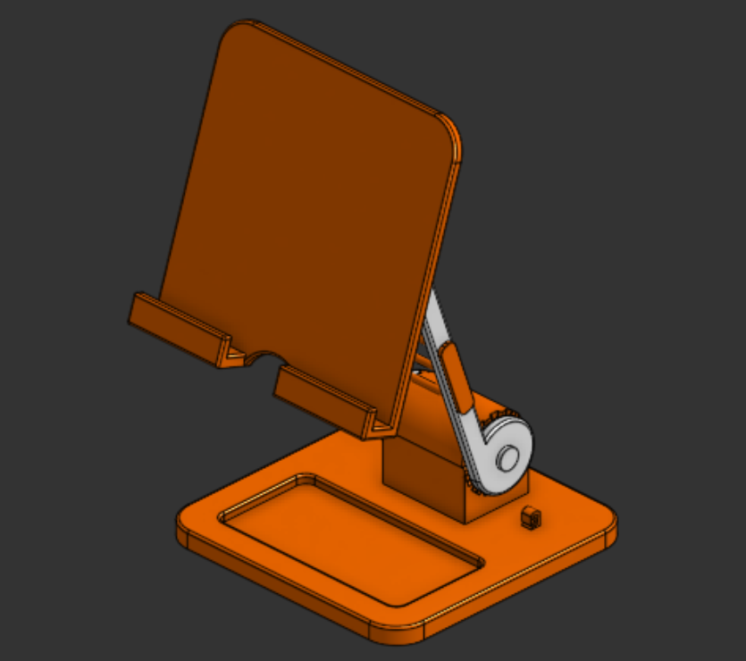
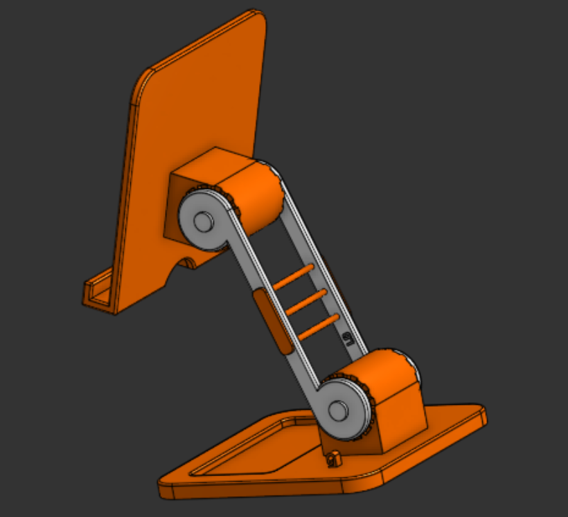

# tab-mount
Tab Mount is a minimal, portable tablet stand designed to provide convenient, hands-free use.

## What is this?
Tab Mount is a compact, minimal, and sleek tablet stand to mount your tablet for very convenient, hands-free use. It rotates on 3 axes, with the 3rd axis being the base rotation itself. Height adjustable for a variety of tablets gives comfort and organizes your desk, especially paired with my other Organizer projects. Designed from scratch in Onshape, this stand is very easy to build. Moreover, this also shares colors with my other Organizer projects.





## Repository Structure
```text
tab-mount/
1] Assets/----> All the images and visual references of the project
2] Hardware/--> Source design files
3] BOM.csv----> Bill of materials
4] LICENSE----> MIT License
5] README.md --> Detailed project documentation and instructions
```

## Live 3d view in Onshape
Click [here](https://cad.onshape.com/documents/0599d35e668904b326db6ffd/w/52e933024b0d605fec7c9338/e/d75de9f8ec687e93c6404785) to view Tab Mount in Onshape!

## How to get your own Tab Mount?
1. Download the source CAD .step files from the [Hardware](Hardware/) directory
2. Import the file into your CAD editor and make edits as you want (Optional)
3. Go to your fabricater/ manufacturer website, get a quote, and purchase it (For Example, [ROBU](https://robu.in) or [JLCPCB](https://jlcpcb.com))
4. That's it! Wait for it to arrive!
5. You will need superglue to assemble this stand
6. Use the stem to lock the supports with the main base
7. Use superglue to lock the stem in place
8. Similarly, use the another stem to lock the support with the holder
9. Now, use superglue to lock this stem in place too
10. Lastly, stick the trio stems across the two supports to add strength to the support arms
11. That's it! Mount your tablet!

## [BOM](BOM.csv) as a table
| Item     | Description  | Quantity | Price (USD) | Link                             |
|----------|--------------|----------|-------------|----------------------------------|
| 3D print | PLA (350 gm) | 1        | 18          | https://printlegion.hackclub.com |
| Shipping |              |          | 1           |                                  |
| Total    |              |          | 19          |                                  |

## Fabrication Specs
1. Printer- 0.2 mm Standard Quality
2. Material- PLA
3. Color- Orange & White
4. Infill- 50%

## License
[MIT](LICENSE)- Use, modify, share as you like!

## Notes
- If ya'll like this project, make sure to see my other projects [Hold 90](https://github.com/vd-sh/hold-90), [Keeb Stand](https://github.com/vd-sh/keeb-stand), or [Headset Stand](https://github.com/vd-sh/headset-stand)
- Or simply visit my [profile](https://github.com/vd-sh) to see the latest projects :)
